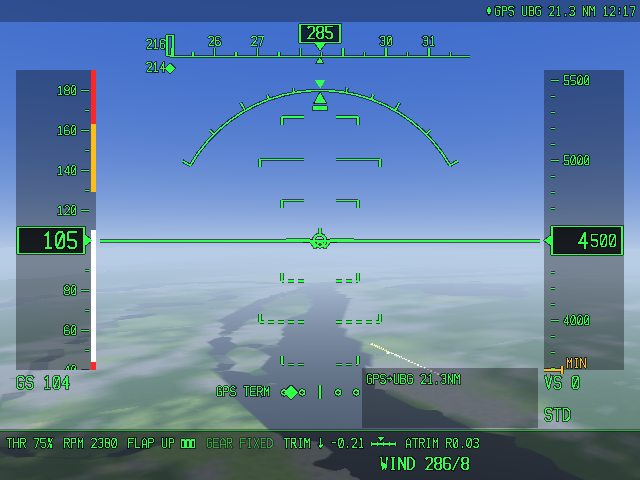
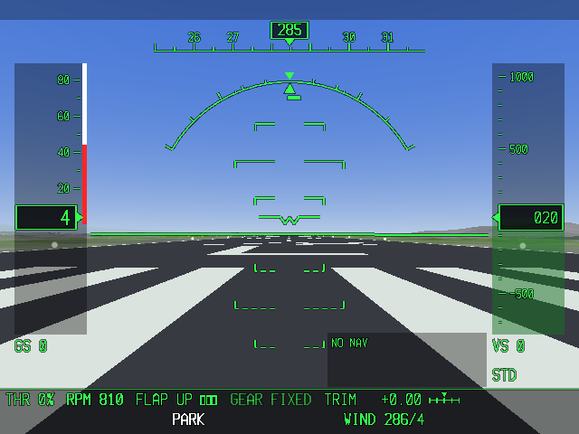

# Pocket Vectors

**Retro flight sim with modern data.**

Pocket Vectors is a first-person flight simulator for the Anbernic RG40XXH. You fly from a HUD,
with a real flight model, real terrain, and real airports. The v1.0 release carries the Pacific
Northwest: terrain streamed from Portland (KPDX) to the coast at North Bend (KOTH).



## Features

- **JSBSim flight model**, using stock aircraft from the Cessna 172 up through airliners.
- **Worldwide airports** and runways, with markings, lights and PAPI.
- **FAA approaches, fixes and airways**, plus a synthesized ILS for any runway.
- **Terrain streamed for the KPDX to KOTH region** in the release data pack (Copernicus DEM and
  ESA WorldCover).
- Flight plans built in game or loaded from X-Plane `.fms` files, a moving map, autopilot and a
  full HUD.

## Supported device

Tested on the **Anbernic RG40XXH stock OS**: 64-bit userspace and SDL2 (`libSDL2-2.0.so.0`).
PortMaster is optional. Other PortMaster handhelds are untested. If buttons land on the wrong
actions, open Help in the game (button test) or edit `flightsim/conf/controls.ini`
([install notes](flightsim/INSTALL.md), [controls](flightsim/docs/CONTROLS.md)).

## Install

**v1.0:** download **`pocket-vectors-1.0.0-Roms-PORTS.zip`** from the
[v1.0.0 release](https://github.com/zackm-780/pocket-vectors/releases/tag/v1.0.0) and unzip it
into `Roms/PORTS` on the SD card. The top of the zip is `FlightSim.sh` and `flightsim/` (the game
and the `pdx_oth` data). If your unzip tool creates a folder named after the zip, move those two
items into `Roms/PORTS`.

The on-card folder stays `flightsim/`, the script stays `FlightSim.sh`, and the binary stays
`flightsim.aarch64`, so an update keeps `flightsim/conf/` and `flightsim/data/`.

Later tagged releases attach a **game-only** zip (`FlightSim.sh` and `flightsim/`, no probe and
no terrain). Combine that zip with a data pack, and any `.fms` plans, then unzip the result into
`Roms/PORTS`:

```bash
python3 flightsim/tools/sdcard/make_sdcard_zip.py \
  --game pocket-vectors-vX.Y.Z-game.zip \
  --data pdx_oth.zip \
  --plan trip.fms \
  --out ports.zip
```

Python 3.8 or newer, standard library only (Windows, macOS, and Linux). The script checks the
binary, that `libs.aarch64/libJSBSim.so.1` is a regular file, and that `data/terrain` and
`data/nav/nav.ini` are present. Details: [flightsim/INSTALL.md](flightsim/INSTALL.md) and
[flightsim/tools/sdcard/README.md](flightsim/tools/sdcard/README.md).



## Flight plans

Put X-Plane `.fms` files (version 1100) in `flightsim/data/plans/`. SimBrief and Little Navmap
both export that format. List every waypoint: an airway name in the file is kept as a note, and
the game flies direct between the points that are written down. An approach line uses the ARINC
name without `RW` (for example `I28L`). In the game, New flight then Flight plan loads a file or
builds a quick plan (direct, or via navaids along the great circle). Sample plans ship with the
game (`KPDX-KOTH.fms`, `KOTH-KPDX.fms`, `XTST-pattern.fms`). See
[flightsim/src/nav/README_FMS.md](flightsim/src/nav/README_FMS.md).

## More regions

Tagged releases do not include a terrain pack. Build one and keep its `ATTRIBUTION.txt`
(Copernicus DEM is free for worldwide use with that notice; ESA WorldCover is CC BY 4.0).

- Actions tab, workflow **datapack**. Presets: `pdx_oth`, `bayarea`, `mthood`, `tam_diablo`.
  Or set **bbox** to `west,south,east,north`. Download the artifact (kept 30 days), unzip once,
  and pass that folder or zip to `--data`.
- Or locally: `flightsim/tools/datapack/build_datapack.sh --out /path/to/pack --preset bayarea`
  (or `--bbox`). See [flightsim/tools/datapack/README.md](flightsim/tools/datapack/README.md).

## Controls

On the RG40XXH the defaults match the printed labels: A gear, B brakes, X speedbrake, Y HUD
declutter, Select map, Start pause, Select+Start quit. The Menu key also acts as Select. R3 is
not used in flight. The in-game **Help** menu lists the live bindings, has a button test, and
holds the how-to pages. Full map: [flightsim/docs/CONTROLS.md](flightsim/docs/CONTROLS.md).

## Troubleshooting

If the port does not start, read `flightsim_launch_log.txt` next to `FlightSim.sh`. Its
`candidate` lines list every folder the script checked for `flightsim.aarch64`, and `GAMEDIR=`
is the folder it used. The game also writes `flightsim/conf/log.txt`. `FlightSim.sh` must stay
LF (editing it in Notepad can break `#!/bin/bash`). `libJSBSim.so.1` must stay a normal file,
not a shortcut. More: [flightsim/INSTALL.md](flightsim/INSTALL.md).

## Building from source

Desktop: see [flightsim/docs/BUILD_AND_DEPLOY.md](flightsim/docs/BUILD_AND_DEPLOY.md). The
**device** workflow builds the handheld game (Debian 11, aarch64). The **datapack** workflow
builds `data/`. The on-device probe is only in that device-workflow artifact
(`FlightSimProbe.sh` and `flightsimprobe/`), not in a release zip.

## Roadmap

Open work and known issues: [ROADMAP.md](ROADMAP.md).

## Contributing

Contributions are welcome. Read [CONTRIBUTING.md](CONTRIBUTING.md). Every outside contribution
comes in as a fork and a pull request, CI has to pass (including the device workflow), and the
owner reviews and approves it before merge. Also see [CLAUDE.md](CLAUDE.md),
[flightsim/docs/CONVENTIONS.md](flightsim/docs/CONVENTIONS.md) and
[flightsim/docs/WORK_PACKAGES.md](flightsim/docs/WORK_PACKAGES.md). Contributions are accepted
under Apache-2.0.

Source and the on-device port both live under `flightsim/` so the card layout does not change
between versions.

## Licence

The code is licensed under the [Apache License 2.0](LICENSE). Forks and redistributions keep the
copyright notice and the [NOTICE](NOTICE) file. JSBSim (LGPL-2.1) and SDL2 (zlib) keep their own
licences. Data packs carry their sources' terms in `ATTRIBUTION.txt` (Copernicus DEM, ESA
WorldCover, OurAirports, FAA NASR and CIFP, WMM).

## Author and support

Made by **Zack Martin** ([@zackm-780](https://github.com/zackm-780)).
If you enjoy it and want to support the work: [buymeacoffee.com/zackm](https://buymeacoffee.com/zackm).
