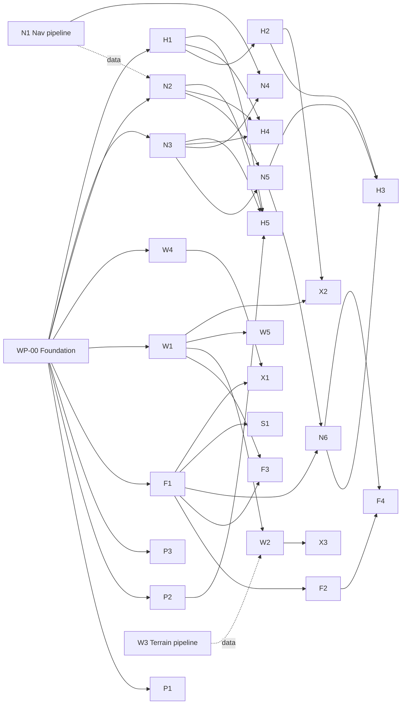

# Work packages

Each work package (WP) is sized for **one implementer agent**. The **Model / effort** line says which
model and effort to run it with (policy in [AGENTS.md](AGENTS.md)). **Owns** lists the paths the WP
may create or edit. **Depends** lists WPs that must be merged first. "(interface)" means only the
`core/` contract is needed, so the WP can start with stubs or fakes.

Status lives in each WP's own `Status:` line, so parallel PRs don't conflict. Values: `todo`,
`in progress (<branch>)`, `in review (<PR>)`, `done (<PR/commit>)`, `blocked (<why>)`.

## Waves

| Wave | Start when | WPs (run in parallel) |
|---|---|---|
| **0** | now | **WP-00**, **P1** (toolchain + probe; packaging of the main binary after WP-00), **W3**, **N1** |
| **1** | WP-00 merged | P2, F1, W1, W4, N2, N3, H1 |
| **2** | its deps merged | P3, F2, F3, W2, W5, N5, H2 |
| **3** | its deps merged | N4, N6, H3, H4, H5, X2 |
| **4** | its deps merged | F4, S1, X1, X3, X4 |

## Summary

| WP | Title | Model / effort | Depends | Milestone |
|---|---|---|---|---|
| WP-00 | Foundation skeleton | Sonnet / high | none | M0 |
| P1 | Device toolchain, PortMaster package, device probe | Sonnet / high | WP-00 for final packaging only | M0 |
| P2 | Input system and control mapping | Sonnet / medium | WP-00 | M1 |
| P3 | Settings, persistence, paths | Sonnet / medium | WP-00, P2 | M6 |
| P4 | Downloadable data pack (CI) | Sonnet / medium | W3, N1, N4 | M6 |
| F1 | JSBSim flight model wrapper | Sonnet / high | WP-00 | M1 |
| F2 | Core fleet profiles and flyability tests | Sonnet / high | F1 | M5 |
| F3 | Terrain ground contact | Sonnet / high | F1, W1 | M2 |
| F4 | Extended fleet | Sonnet / medium | F2, N6 | M5 |
| W1 | Terrain runtime (tiles, cache, queries, flattening) | Sonnet / high | WP-00 | M2 |
| W2 | Terrain renderer | Sonnet / high | W1 | M2 |
| W3 | Terrain data pipeline (Python) | Sonnet / high | none (DATA.md spec) | M2 |
| W4 | Sky, atmosphere, fog | Sonnet / medium | WP-00 | M1 |
| W5 | Airports and runways rendering | Sonnet / high | WP-00, W1 (interface) | M1/M2 |
| N1 | Nav data pipeline (Python) | Sonnet / medium | none (DATA.md spec) | M2 |
| N2 | Nav database runtime | Sonnet / medium | WP-00 | M2 |
| N3 | Flight plans and `.fms` IO | Sonnet / medium | WP-00 | M4 |
| N4 | Instrument procedures (FAA CIFP) | Sonnet / high | N1, N3 | M4 |
| N5 | Navigator and approach builder | Sonnet / high | N2, N3 | M3 |
| N6 | Autopilot, flight director, autothrottle | Sonnet / high | F1, N5 | M3 |
| H1 | 2D renderer and stroke font | Sonnet / medium | WP-00 | M1 |
| H2 | Flight HUD | Sonnet / high | H1 | M1 |
| H3 | Nav and autopilot HUD | Sonnet / medium | H2, N5, N6 (interface) | M3 |
| H4 | Moving map page | Sonnet / medium | H1, N2, N3 | M4 |
| H5 | Menus and flight setup | Sonnet / medium | H1, P2, N2, N3 | M3 |
| S1 | Procedural audio | Sonnet / medium | F1 | M6 |
| X1 | Weather (manual + METAR) | Sonnet / medium | F1, W4 | M6 |
| X2 | Terrain and ground warnings, callouts | Sonnet / medium | W1, H2 | M6 |
| X3 | Device performance pass | Sonnet / high | P1, W2 (+ device results) | M6 |
| X4 | Night lighting (stretch) | Sonnet / medium | W2, W4, W5 | M6 |

---

## WP-00: Foundation skeleton
**Status:** done (merged wp/WP-00-foundation) · **Model / effort:** Sonnet / high · **Depends:** none · **Specs:** ARCHITECTURE (all), CONVENTIONS, BUILD_AND_DEPLOY §1–4

**Owns:** `flightsim/CMakeLists.txt`, `flightsim/cmake/` (except the aarch64 toolchain, which P1 owns),
`src/main.cpp`, `src/core/`, `src/app/`, `src/platform/`, `src/gfx/` (base files), minimal
`src/sim/` bootstrap, `tests/` harness, `assets/scenarios/` (initial files), `.clang-format`,
`.github/workflows/ci.yml`.

**Deliverables**
1. CMake (≥ 3.18, which JSBSim requires; C++17): targets `flightsim` and `flightsim_tests`. FetchContent for JSBSim **v1.3.3**
   (shared library, Python/docs/tests off), doctest, stb_image_write. SDL2 via `find_package`.
   `-Wall -Wextra` on our code (not deps); `FSIM_WERROR=ON` in CI.
2. A runtime layout step that copies `aircraft/`, `engine/` and `systems/` from the JSBSim source
   for the **core fleet** into `<build>/jsbsim/`, then copies `assets/jsbsim-overlay/` and `assets/` on top.
3. Platform: SDL2 window (desktop default 1280×960, `--window`, `--fullscreen`), GLES2 context with
   a desktop GL 2.1 fallback, GL function loader, shader preamble, vsync, MSAA if available.
4. All `core/` contracts from ARCHITECTURE §5, compiling and documented, plus implementations of
   `Units`, `Geo` (with unit tests against known values), `Ini`, `Csv`, `Log`, `Paths`.
5. Stubs so the app runs end to end: `FlatTerrain`, `SyntheticNavDb` (XTST per ARCHITECTURE §9),
   a minimal `FlightModel` that loads `c172p`, starts at a runway or on final, and steps with
   `ControlInputs`. F1 replaces its internals.
6. App: game state machine (Flying/Paused stubbed), fixed-step loop (ARCHITECTURE §3), keyboard
   pitch/roll/throttle debug controls (P2 replaces these), CLI flags and scenario loader
   (ARCHITECTURE §9), `--headless`, `--trace`, `--screenshot`.
7. Debug renderer: sky clear color, flat ground grid around the camera in RTC/ECEF (section 4 rules),
   one runway quad at XTST, first-person camera from the eye point. A placeholder that W2/W4/W5 replace.
8. Tests: doctest harness, `ctest` integration, Geo/Ini/Csv tests, and a headless smoke test that
   flies 30 s from `c172_runway_xtst.ini` and asserts the state is valid and not crashed.
9. CI (`.github/workflows/ci.yml`, Ubuntu): build, run tests, headless scenario, screenshot under
   Xvfb uploaded as an artifact.

**Acceptance:** fresh clone builds with the CLAUDE.md commands. Tests pass. Headless run writes a
sensible trace (with full throttle on the runway, IAS rises past 55 kt). The screenshot shows sky,
ground grid and runway from the cockpit eye point. CI green. ARCHITECTURE §5 matches the headers;
any deviation is documented in the PR.

## P1: Device toolchain, PortMaster package, device probe
**Status:** done (merged wp/P1-device-toolchain; needs device test) · **Model / effort:** Sonnet / high · **Depends:** none to start; WP-00 for packaging the main binary · **Specs:** BUILD_AND_DEPLOY, DEVICE

**Owns:** `cmake/toolchain-aarch64.cmake`, `tools/docker/`, `tools/build_device.sh`, `tools/probe/`,
`port/`, `.github/workflows/device.yml`, `docs/DEVICE.md` (results section).

**Deliverables**
1. A reproducible aarch64 build: Docker image based on Debian 11 (bullseye) with a cross g++ and
   `libsdl2-dev:arm64` (or native arm64 under QEMU if cross-compiling proves impractical). CMake
   toolchain file. `tools/build_device.sh` produces `dist/flightsim-portmaster.zip`.
2. Port folder per BUILD_AND_DEPLOY §6: `FlightSim.sh` (PortMaster template: control.txt, get_controls,
   GAMEDIR, conf dir, log tee, `LD_LIBRARY_PATH=libs.aarch64`, `SDL_GAMECONTROLLERCONFIG`, gptokeyb
   **for the exit hotkey only**, `pm_platform_helper`, `pm_finish`, `FLIGHTSIM_PLATFORM=portmaster`),
   `flightsim.aarch64`, `libs.aarch64/libJSBSim.so.1` (regular file, no soname symlinks), `jsbsim/`, `assets/`, `licenses/`,
   `port.json`, `gameinfo.xml`, `README.md`.
3. **Device probe** (`tools/probe/`, own tiny SDL2+GLES2 program, packaged as port "Flight Sim Probe"):
   writes `probe_report.txt` with glibc version, kernel, CPU/RAM, SDL version, video driver, display
   modes, GL_VENDOR/RENDERER/VERSION/EXTENSIONS, max texture size, depth/stencil/MSAA configs
   obtained, controller name/GUID/mapping, and live logging of every button/axis press for 20 s with
   on-screen prompts ("press L2", "move right stick"...). Also a GPU benchmark (fill rate; triangle
   throughput at 10k/40k/80k tris with a fog shader; frame times) and a CPU benchmark (JSBSim c172p
   and 737 at 120 Hz, µs per step).
4. CI job building the device zip and checking `objdump -T` for max `GLIBC_` ≤ 2.31 and `ldd`-style
   dependencies limited to libc/libm/libdl/libpthread/librt/libSDL2-2.0.so.0 plus our shipped libs.

**Acceptance:** zip builds in CI. Probe runs on desktop. Human device test: probe report captured and
pasted into DEVICE.md, and the main port launches and exits with Select+Start 📱.

## P2: Input system and control mapping
**Status:** done (merged wp/P2-input; needs device test: button labels, L2/R2 analog, feel) · **Model / effort:** Sonnet / medium · **Depends:** WP-00 · **Specs:** CONTROLS, ARCHITECTURE §5 (Actions, ControlInputs)

**Owns:** `src/input/`, `tests/input/`, `assets/controls_default.ini`.

**Deliverables:** SDL GameController and keyboard → `ActionState`, with deadzones, expo curves,
axis-dominance filter (right stick), shift layers (L1 = autopilot layer, R1 = systems layer, L2 =
look), auto-repeat for held buttons, and remapping from `controls.ini`. `PilotControls` integrates
actions into `ControlInputs`: throttle rate integration, trim integration, detent stepping by
profile, gear and speedbrake toggles, brakes, parking brake, steering = rudder. On-screen feedback
messages ("FLAPS 15", "GEAR DOWN", "TRIM NOSE UP") go through a small message queue API. Keyboard
input is ignored when `FLIGHTSIM_PLATFORM=portmaster`, because gptokeyb may inject keys.

**Acceptance:** unit tests for curves, layers, throttle/trim integration and detent stepping. Desktop
playable with keyboard and any gamepad. Default mapping matches CONTROLS.md exactly.

## P3: Settings, persistence, paths
**Status:** done (merged wp/P3-settings; needs device test: conf dir + fsync on SD) · **Model / effort:** Sonnet / medium · **Depends:** WP-00, P2 · **Specs:** ARCHITECTURE §8, CONTROLS §4

**Owns:** `src/app/Settings*`, `tests/app/settings*`.

**Deliverables:** `settings.ini` (units, FOV, HUD color and declutter default, assists, sim Hz,
data dir, graphics quality), persisted control remaps, "resume last flight" (aircraft, position,
config, plan), and safe writes (write temp, then rename).
**Acceptance:** round-trip tests. Corrupt or missing files fall back to defaults.

## P4: Downloadable data pack (CI)
**Status:** done, merged (workflow must be on the default branch to run; first full run is the real test) · **Model / effort:** Sonnet / medium · **Depends:** W3, N1, N4 · **Specs:** DATA §2-3, §8, BUILD_AND_DEPLOY §7

**Owns:** `.github/workflows/datapack.yml`, `tools/datapack/`, BUILD_AND_DEPLOY §7 data steps.

**Deliverables:** `tools/datapack/build_datapack.sh` (venv, terrain region + optional world layer,
nav with NASR and CIFP, validation, `ATTRIBUTION.txt`, `README.txt`, size and per-directory file
counts), and a manual `datapack` workflow that caches downloads, zips the pack and uploads it as an
artifact (30 days). No generated data is committed.
**Acceptance:** a small-bbox run produces a pack the game loads (`--data-dir`); script passes
shellcheck; workflow YAML parses.

## I1: Integration follow-ups
**Status:** done, merged (needs device test: R1 baro keys, altimeter line placement) · **Model / effort:** Sonnet / medium · **Depends:** N4, N5, N6, H2, H3, X1, P3 · **Owns:** small fixes across merged modules (assigned by the supervisor)
1. **Late-joining transitions:** `Navigator::loadApproach` builds real approaches with N4's `assembleApproachLegs()` (skips the final legs before the join, e.g. KOTH I05-Y via OTH3 is OTH, EMIRE, EMIRE, RW05); the FAF comes from `Approach::fafFinalLeg` (additive core field, set by N4) instead of the distance heuristic. Tests: `procedures_navigator_test.cpp`. The perfect-pilot flight test no longer flies I05-Y/OTH3 (the fixture has no procedure turn, the 200 degree turn at EMIRE overshoots).
2. **Short ids:** `findApproach(aps, "I05")` skips helicopter procedures (`Approach::helicopterOnly`, from a COPTER title), then takes the last suffix letter (I05-Z). H5's list shows "ILS Y RWY 05 (COPTER)". The KOTH fixture title for I05-Y now says COPTER.
3. **Baro:** altitude line under the tape (`STD`, `29.92` or `1013`, per pressure units); R1 + D-pad up/down steps 0.01 inHg or 1 hPa, R1 + Select sets STD (keys 8, 7, 6 on the keyboard; actions BaroInc/BaroDec/BaroStd, additive); N6 bug, capture, hold, ALT mode and the minimums disconnect use indicated altitude. Not changed: N5 VNAV and altitude constraints still compare true altitude.
4. **H3 bugs and armed modes:** skipped, already shown (VS target in the FMA vertical column, speed bug on the speed tape with A/T or AP on, armed modes in parentheses).
5. **[weather] in last_flight.ini:** `scenarioToIni` writes the section (uniform legacy winds stay in `[wind]`).
6. **Demo landings:** new `[scenario] end_agl_ft`; headless runs stop on the way down through it. `ap_ils_737.ini` and `ap_ils_c172.ini` use 100 ft. The AP disconnect rule is unchanged.

## F1: JSBSim flight model wrapper
**Status:** done (merged wp/F1-flight-model) · **Model / effort:** Sonnet / high · **Depends:** WP-00 · **Specs:** ARCHITECTURE §5, §7

**Owns:** `src/sim/` (replaces the WP-00 bootstrap), `tests/sim/`, `src/sim/README.md` (property map).

**Deliverables:** `FlightModel` load/reset/step/state for any profile. Profile INI loader into
`AircraftProfile`. Verified property mapping (ARCHITECTURE §7), recorded in `sim/README.md`. Start
conditions runway/final/cruise with trim and trim transfer, engine start, eye point, gear
protection, crash detection, wind from scenario, and reset without leaking JSBSim instances.
Profiles for `c172p` (core) and a draft `737` so jet paths are exercised.

**Acceptance (headless tests):** (a) c172p runway start at full throttle lifts off between 50 and 65 kt
with stick back. (b) c172p 6 NM final start holds the 3° path ±150 ft for 60 s with no inputs after
trim. (c) Reset 100 times with no growth in RSS. (d) Hard-impact scenario sets `crashed`. (e) The 737
cruise start holds altitude ±200 ft for 60 s.

## F2: Core fleet profiles and flyability tests
**Status:** done, merged (needs device test: c310 fixed-pitch feel; follow-up: per-detent stall-warning alpha for the 747/737) · **Model / effort:** Sonnet / high · **Depends:** F1 · **Specs:** PLAN §5, ARCHITECTURE §5 (AircraftProfile)

**Owns:** `assets/aircraft/{c172p,c310,global5000,737,B747}.ini`, `assets/jsbsim-overlay/` (only if
a stock file needs a fix), `tests/fleet/`.

**Deliverables:** complete profiles with flap detents and labels, speeds from the aircraft's
published numbers, approach and takeoff configurations, and property overrides (reversers,
speedbrakes). A parameterised headless test suite run per aircraft: takeoff, climb, trimmed cruise,
configuration changes, stabilized 3° approach from 8 NM, landing rollout to stop with brakes (and
reversers if present).

**Acceptance:** all 5 aircraft pass, or a documented exception approved by the supervisor.

## F3: Terrain ground contact
**Status:** done, merged (needs device test: step cost with terrain; follow-up: DEM vs runway elevation step at KPDX pads) · **Model / effort:** Sonnet / high · **Depends:** F1, W1 · **Specs:** ARCHITECTURE §5 (TerrainQuery), §7

**Owns:** `src/sim/GroundCallback*`, `tests/sim/ground*`.

**Deliverables:** `JSBSim::FGGroundCallback` over `TerrainQuery`: contact point, normal from terrain
gradient, AGL, plus runway flatten areas honoured. Spawn gating (`isDetailReady`) for starts.
**Acceptance:** landing on a sloped synthetic tile set behaves correctly, and a runway on rough
synthetic terrain rolls flat. The c172p can't sink through terrain at 120 Hz.

## F4: Extended fleet
**Status:** done, merged (A320, 787-8, MD11, c182, pa28; DHC6 and J3Cub skipped: no trim / tail-dragger without flaps; needs device test: airliner frame cost and load time) · **Model / effort:** Sonnet / medium · **Depends:** F2, N6 · **Owns:** `assets/aircraft/` (extended ids), `tests/fleet/`, extended-fleet overlay and scenario files
Profiles plus flyability tests and autopilot gains for `pa28`, `c182`, `J3Cub`, `DHC6`, `A320`, `787-8`, `MD11`.

## W1: Terrain runtime
**Status:** done (merged wp/W1-terrain-runtime; needs device test: SD-card load times) · **Model / effort:** Sonnet / high · **Depends:** WP-00 · **Specs:** DATA §3–4, ARCHITECTURE §3, §5

**Owns:** `src/world/terrain/`, `tests/world/terrain/`, `tools/fixtures/make_synthetic_terrain.py`.

**Deliverables:** reader for terrain format v1 (`pack.ini`, `.h16`, `.lc8`), worker-thread loader
with priority by distance and LOD, LRU cache with a memory cap, parent-tile fallback,
`TerrainService : TerrainQuery` (bilinear elevation, land class, flatten areas with blending,
prefetch, `isDetailReady`), and an API for W2 to enumerate resident tiles and LOD selection inputs.
**Acceptance:** unit tests on synthetic packs (edges, seams across tiles and levels, fallback,
flatten blend). No blocking on the main thread. Cache stays under its cap in a fly-through test.

## W2: Terrain renderer
**Status:** done, merged (needs device test: GPU cost on Mali-G31, depth precision, upload hitching; Portland view is 46k triangles, over the 40k budget) · **Model / effort:** Sonnet / high · **Depends:** W1 · **Specs:** ARCHITECTURE §4, §6; DATA §4

**Owns:** `src/world/TerrainRenderer*`, `src/gfx/` additions it needs (new files only), `assets/shaders/terrain*` if shaders are external.

**Deliverables:** chunked LOD (CDLOD or geomipmapping) over the tile pyramid with skirts or
stitching (no cracks), RTC/ECEF placement (curvature is automatic), land-class coloring with a
detail texture and slope shading, flat water, fog, a GPU upload budget per frame, and a frustum and
horizon culling budget.
**Acceptance:** screenshots of synthetic and real regions. No cracks or popping at the default
setting. Triangle counts are logged and stay within PLAN §3 budgets.

**As built (W2):** CDLOD quadtree of 16x16-cell patches ("nodes", `src/world/TerrainRendererMesh.h`
explains the scheme). Node level m reads tile level m-4 at step 1, the coarsest tile at a larger
step above that, and the finest resident ancestor while its natural tile streams in. A node splits
when its box is closer than `cellMeters * focalPx / pixelsPerCell` (default 10 px on a 480-line
screen, shrunk by sqrt(sin grazing angle) for foreshortened views) and only once its four children
have meshes, so nothing disappears while data loads. Skirts hide cracks; geomorphing removes
popping. One shared 16-bit index buffer, 357 vertices (32 B) per node, one draw per node plus one
for the camera-centred sea disc (ocean = no tile). Tuning knobs: `TerrainRenderConfig` / `LodConfig`.
Dev hooks (environment, no CLI flags exist yet): `FSIM_W2_CAMERA=lat,lon,altFt,hdgTrueDeg[,pitchDeg]`,
`FSIM_W2_VISIBILITY_KM`, `FSIM_W2_PX_PER_CELL`.

## W3: Terrain data pipeline (Python)
**Status:** done (merged wp/W3-terrain-pipeline) · **Model / effort:** Sonnet / high · **Depends:** none · **Specs:** DATA (all)

**Owns:** `tools/terrain/` (including `tools/terrain/requirements.txt`).

**Deliverables:** `build_terrain.py` with `--bbox` / `--preset`, `--min-level`, `--max-level` and
`--out`. It downloads Copernicus GLO-30/GLO-90 DEM and ESA WorldCover for the needed cells
(cached), mosaics, resamples to the tile pyramid (DATA §4: bilinear heights, mode for land class),
fills voids, forces ocean to 0, and writes `pack.ini` with attribution. Also `--world` mode
(levels 0–6 globally, GLO-90) and a size estimator (`--dry-run`). Region presets: **`pdx_oth`** (primary, PLAN D19: bbox −124.7,43.0,−121.4,46.3) and `bayarea`.
**Acceptance:** builds a small preset end to end. A validation script checks tile edges match their
neighbours and parents, and a spot elevation of a known peak is correct within the source accuracy.
Documented runtime and size per preset.

## W4: Sky, atmosphere, fog
**Status:** done (merged wp/W4-sky; needs device test: sky cost on Mali) · **Model / effort:** Sonnet / medium · **Depends:** WP-00 · **Specs:** ARCHITECTURE §6

**Owns:** `src/world/Sky*`, `src/world/Atmosphere*`, `tests/world/sky*`.

**Deliverables:** sky gradient (zenith to horizon haze, sun disc from date/time/position), shared fog
parameters (visibility setting, haze color), and a sun direction for terrain shading.
**Acceptance:** screenshots at ground level and 35,000 ft. The fog matches between sky and ground.

## W5: Airports and runways rendering
**Status:** done, merged (needs device test: GLES2 point sprites, frame time) · **Model / effort:** Sonnet / high · **Depends:** WP-00; W1 interface (flatten); N2 for real data · **Specs:** NAVIGATION §3 (lights/PAPI), DATA §5

**Owns:** `src/world/Airport*`, `tests/world/airport*`.

**Deliverables:** for airports near the camera (from `NavDatabase`): runway surfaces (paved vs
grass), markings (threshold bars, designators drawn with the stroke font geometry, centerline,
touchdown zone and aiming point), edge, threshold and end lights, approach lights (simplified ALSF
or MALSR for ILS runways), **functional PAPI** (4 units, per-unit transition angles around 3°), and
generic apron and building blocks. Registers flatten areas with `TerrainQuery`.
**Acceptance:** XTST screenshots from 10 NM, 2 NM, threshold and on the runway. A PAPI unit test
shows 2 red / 2 white on the glidepath, all white when high, all red when low.

**Notes (W5):** `world/AirportGeometry.*` is GL-free (markings, lights, PAPI logic, flatten quads,
mesh builders); `world/AirportRenderer.*` draws it. Pavement and markings use the flat mean of the
two runway-end elevations, the same value registered with `addFlattenArea` (one area per runway
pair). The renderer clears ALL flatten areas whenever the active airport set changes and
re-registers the whole set. Terrain must draw with polygon offset >= 0; airports use (-1,-1) for
pavement/apron and (-2,-2) for markings. Lights are additive point sprites with a clip-space depth
bias, fogged over half the distance of surfaces. Runways with an ILS (real or synthesized, not
`approx`) get the MALSR; hard runways >= 3,000 ft (not `approx`) get the PAPI.

## N1: Nav data pipeline (Python)
**Status:** done (merged wp/N1-nav-pipeline) · **Model / effort:** Sonnet / medium · **Depends:** none · **Specs:** DATA §5–6

**Owns:** `tools/nav/` (except `cifp*`; including `tools/nav/requirements.txt`).

**Deliverables:** `build_navdb.py`: OurAirports → `airports.csv`, `runways.csv` (one row per landing
direction, threshold displacement applied, headings computed from end coordinates, `approx` flag),
`navaids.csv`. Optional FAA NASR → `ils.csv`, `fixes.csv`, `airways.csv`. WMM → `magvar.bin`.
`nav.ini` records the source dates.
**Acceptance:** schema validation script. Spot checks on KPDX (10L/28R, 10R/28L, 03/21) and KOTH
runway thresholds, plus their ILS frequencies when NASR is available, and KSFO. Runs offline from
cached downloads.

## N2: Nav database runtime
**Status:** done (merged wp/N2-navdb; device load time to be measured) · **Model / effort:** Sonnet / medium · **Depends:** WP-00 · **Specs:** DATA §5–6, ARCHITECTURE §5 (NavDatabase)

**Owns:** `src/nav/NavDb*`, `src/nav/MagVar*`, `tests/nav/navdb*`, `tests/fixtures/nav/`.

**Deliverables:** CSV loaders, grid spatial index, `NavDatabase` implementation, `MagVar` lookup,
synthesized ILS for any hard runway without real ILS data (NAVIGATION §3.2), and a merge with
SyntheticNavDb (XTST always present). Load time measured.
**Acceptance:** fixture-based tests (ident lookup, ambiguity, nearest, box query, magvar
interpolation, synthesized ILS geometry). Full-world load ≤ 3 s on desktop (device time recorded later).

## N3: Flight plans and `.fms` IO
**Status:** done (merged wp/N3-flightplans) · **Model / effort:** Sonnet / medium · **Depends:** WP-00 · **Specs:** NAVIGATION §2

**Owns:** `src/nav/FlightPlan*`, `src/nav/Fms*`, `tests/nav/plan*`, `assets/plans/` (samples).

**Deliverables:** X-Plane 11 `.fms` parser and writer, plan building (resolve idents via
`NavDatabase` with nearest-to-previous disambiguation), quick plan (origin/runway → destination,
direct), insert/delete/direct-to, distances and ETE, and approach insertion API (used by N4/N5).
Sample plans in `assets/plans/`: `KPDX-KOTH.fms` and `KOTH-KPDX.fms` (PLAN D19).
**Acceptance:** round-trip tests on sample files (including SimBrief-style exports). Malformed files
give readable errors.

## N4: Instrument procedures (FAA CIFP)
**Status:** done, merged (needs device test: procedures pack load time; follow-ups for N5: assembleApproachLegs for late-joining transitions, fafFinalLeg) · **Model / effort:** Sonnet / high · **Depends:** N1, N3 · **Specs:** NAVIGATION §3, DATA §7

**Owns:** `tools/nav/cifp*`, `src/nav/Procedures*`, `tests/nav/procedures*`.

**Deliverables:** an ARINC 424 parser for approach records (final approach, transitions, missed
approach) → `procedures/<ICAO>.proc` (format defined and documented by this WP in DATA §7). Runtime
loader → `Leg` lists. Leg types IF/TF/CF/DF/CA/VA/FA/RF/HM/HA/HF, with others approximated and
logged. Approach selection API by airport and runway.
**Acceptance:** the KOTH approaches (all of them) and KPDX ILS 10R/28L parse with correct fixes,
altitudes and missed approach (checked against the published charts).
Unsupported legs are counted in a report across all US airports.

## N5: Navigator and approach builder
**Status:** done, merged (additive NavState fields, see NAVIGATION 4.1; needs device test: per-step cost) · **Model / effort:** Sonnet / high · **Depends:** N2, N3 · **Specs:** NAVIGATION §3–4

**Owns:** `src/nav/Navigator*`, `src/nav/ApproachBuilder*`, `tests/nav/navigator*`.

**Deliverables:** `NavState` production: leg sequencing (fly-by turn anticipation, fly-over), XTK,
DTK, CDI with phase scaling, angular LOC/GS deviation from antenna geometry, GPS→LOC switching,
phases, advisory VNAV (TOD, required VS), minimums, synthesized ILS/visual/RNAV approaches for any
runway (NAVIGATION §3.2), and missed-approach sequencing.
**Acceptance:** geometry tests (deviation signs and scales, sequencing on synthetic routes). A
headless "perfect pilot" (ideal follower) flies a full XTST plan and approach.

## N6: Autopilot, flight director, autothrottle
**Status:** done, merged (needs device test: L1-layer bug repeat and VS/speed axis feel; FLC and go-around not implemented) · **Model / effort:** Sonnet / high · **Depends:** F1, N5 · **Specs:** NAVIGATION §5, CONTROLS (AP layer)

**Owns:** `src/autopilot/`, `tests/autopilot/`, `[autopilot]` keys in aircraft profiles (coordinate with F2/F4).

**Deliverables:** modes per ARCHITECTURE §5 (ROL/HDG/NAV/LOC, PIT/ALT/ALT*/VS/GS, SPD/RETARD),
cascaded controllers, AP-managed pitch trim, pilot override disconnect, auto-disconnect below
minimums − 50 ft, FD commands, and per-aircraft gains.
**Acceptance (headless, c172p and 737):** 90° heading change with overshoot < 5°. Altitude capture
overshoot < 100 ft. ILS from 10 NM holds within 1 dot to 200 ft AGL. LNAV through a 5-leg plan with
XTK < 0.3 NM after the intercept.

## H1: 2D renderer and stroke font
**Status:** done (merged wp/H1-renderer2d; needs device test: edge quality without MSAA) · **Model / effort:** Sonnet / medium · **Depends:** WP-00 · **Specs:** HUD §2

**Owns:** `src/hud/Renderer2D*`, `src/hud/StrokeFont*`, `tests/hud/font*`.

**Deliverables:** batched thick lines (quads, round-ish joins, dark outline pass), arcs, filled
rects, clipping rects, color and alpha, the virtual 640×480 transform, and a stroke font (A–Z, 0–9,
`. , : / - + ° % < > [ ] ( ) * # ' "` and arrows) with sizes S, M and L, alignment and measurement.
**Acceptance:** glyph sheet screenshot reviewed by the supervisor. One draw call per frame for the
HUD batch.

## H2: Flight HUD
**Status:** done, merged (needs device test: S/M text legibility at 640×480, frame cost) · **Model / effort:** Sonnet / high · **Depends:** H1 · **Specs:** HUD (all except §6 nav details)

**Owns:** `src/hud/Hud*`, `tests/hud/hud*`.

**Deliverables:** conformal horizon, pitch ladder, bank scale, flight path vector, heading tape,
speed tape with bands and trend, altitude tape with VS and radio altitude, the full status strip
(throttle and engines, flaps, gear, trim, brakes/park, speedbrake, reversers, fuel, wind),
warnings, transient messages, and declutter levels.
**Acceptance:** screenshot set (runway, climb, steep bank, approach, stall warning) checked against
HUD.md. Every status field is visible in FULL declutter.

## H3: Nav and autopilot HUD
**Status:** done, merged (needs device test: S-size text legibility, FD cue and dot spacing; `--hud-fake <name>` shows canned modes) · **Model / effort:** Sonnet / medium · **Depends:** H2, N5/N6 (interface) · **Specs:** HUD §5–6

**Owns:** `src/hud/NavHud*`, `tests/hud/navhud*`.
FMA line, nav box, CDI, LOC/GS scales, bearing and DTK marks on the heading tape, bugs, FD guidance
cue, and minimums. **Acceptance:** screenshot set with faked NavState/AutopilotState covering every mode.

## H4: Moving map page
**Status:** done, merged (needs device test: S text legibility, map frame cost; terrain shading and hold racetrack are follow-ups; `--map <nm>`) · **Model / effort:** Sonnet / medium · **Depends:** H1, N2, N3 · **Specs:** HUD §7

**Owns:** `src/ui/MapPage*`, `tests/ui/map*`.
North-up / track-up modes, zoom 2–160 NM, route legs and waypoints, airports and navaids, aircraft
symbol, optional terrain shading from coarse tiles, and a waypoint info panel.

## H5: Menus and flight setup
**Status:** done, merged (needs device test: D-pad repeat, A/B/X/Y labels, small text; the device launch now opens the main menu; `--menu <screen>`) · **Model / effort:** Sonnet / medium · **Depends:** H1, P2, N2, N3 · **Specs:** CONTROLS §3, NAVIGATION §2.2

**Owns:** `src/ui/` (except MapPage), `tests/ui/`.
Menu framework (D-pad/A/B), pause menu, aircraft select, airport search (on-screen keyboard plus
nearest list), runway select, start type, flight plan screen (load `.fms`, quick plan, direct-to,
approach select), settings screen, and confirmation dialogs.

## S1: Procedural audio
**Status:** done, merged (needs device test: underruns at 512 samples, callback CPU, speaker balance; GPWS tones wired by the supervisor) · **Model / effort:** Sonnet / medium · **Depends:** F1 · **Owns:** `src/audio/`
SDL audio. Engine sound by type and RPM/N1, wind by IAS, gear and flap motor sounds, touchdown,
stall horn, AP disconnect tone, and altitude/minimums alert tones. Volume setting.

## X1: Weather
**Status:** done, merged (needs device test: gust/turbulence feel, low-visibility fog on GLES; follow-ups: baro knob/display, AP on indicated altitude, [weather] in last_flight.ini, on-device METAR refresh) · **Model / effort:** Sonnet / medium · **Depends:** F1, W4 · **Owns:** `src/world/Weather*`
Manual wind, gusts, visibility and QNH. Optional METAR fetch over Wi-Fi for the departure and
destination airports (aviationweather.gov), applied to JSBSim atmosphere and wind and to fog.

## X2: Terrain and ground warnings
**Status:** done, merged (needs device test: alert timing and feel; tones come with S1 via GpwsMonitor::consumeEvent) · **Model / effort:** Sonnet / medium · **Depends:** W1, H2 · **Owns:** `src/hud/Gpws*`
GPWS-lite modes (excessive sink, terrain closure using a look-ahead terrain query, "too low gear/flaps"),
radio altitude callouts (text plus tones), and "MINIMUMS".

## X3: Device performance pass
**Status:** todo · **Model / effort:** Sonnet / high · **Depends:** P1, W2, device measurements · **Owns:** perf-only changes coordinated by the supervisor
Profile on device, tune LOD and budgets, add a quality preset (low/med/high), and update PLAN §3 with
the measured numbers.

## X4: Night lighting (stretch)
**Status:** done, merged (needs device test: city-light speckle size/shimmer, Mali fragment cost, night HUD legibility) · **Model / effort:** Sonnet / medium · **Depends:** W2, W4, W5
Time of day, dark terrain with lit runways and approach lights, and city light speckle from urban land class.

---

# Wave 5: after the first device run (2026-10-21)

The game runs on the RG40XXH since 2026-10-20 (DEVICE.md §3). These packages come from the
user's first flights and requests. Start with [HANDOFF.md](HANDOFF.md). Suggested order: D1 first
(small, fixes what the user hits on every flight), then H6 and R1, then H7 and W6 in parallel.

| WP | Title | Model / effort | Depends | Owns (summary) |
|---|---|---|---|---|
| D1 | Device button labels for the RG40XXH and other PortMaster devices | Sonnet / medium | P2 | `assets/controls_default.ini`, `src/input/`, `tests/input/` |
| H6 | Help menu: controls reference, button test, how-to pages, About | Sonnet / medium | H5, D1 | `src/ui/Help*`, `assets/help/`, `tests/ui/help*` |
| H7 | HUD mini nav display ("fly the pink line") | Sonnet / medium | H3, H4 | `src/hud/MiniNav*`, `tests/hud/mininav*` |
| W6 | World overlays: route waypoints, vertical path, nearby airports, runway highlight | Sonnet / high | W5, N5 | `src/world/WorldOverlay*`, `tests/world/overlay*` |
| R1 | Public release: install README, SD-card zip script, release workflow | Sonnet / medium | none | `README.md`, `flightsim/INSTALL.md`, `flightsim/tools/sdcard/`, `.github/workflows/release.yml` |

Settings keys, pause-menu items and `App.cpp` wiring that these WPs need are integration changes:
describe them in the PR (or make them as small additive edits) and keep each toggle **off by
default unless noted**.

## D1: Device button labels
**Status:** todo · **Model / effort:** Sonnet / medium · **Depends:** P2 · **Specs:** CONTROLS §1, DEVICE.md §2

**Owns:** `assets/controls_default.ini`, `src/input/`, `tests/input/`, `docs/CONTROLS.md` §1.

**Evidence (2026-10-20 device run):** PortMaster's mapping on the stock OS is
`a:b0,b:b1,x:b3,y:b2,back:b8,guide:b6,start:b7,leftshoulder:b4,rightshoulder:b5,lefttrigger:b10,righttrigger:b11`.
The user reports A and B swapped in flight with the current table (`a = b`, `b = a`, `x = y`,
`y = x`), so the printed labels equal the SDL names; X/Y are very likely swapped too (confirm with
the user). The probe shows **Select → SDL `guide`** and the **Menu key → SDL `back`**, so with
`select = back` the physical Select does nothing and Menu acts as Select (map, Select+Start quit).

**Deliverables:**
1. Default label table `a = a`, `b = b`, `x = x`, `y = y`.
2. Let a label list several SDL buttons (`select = back, guide`) and make that the default, so
   Select works on the stock OS (`guide`) and on CFWs where Select is `back`. Chords
   (`select+start`) must accept either. Menu on the stock OS then also acts as Select, which is
   acceptable; say so in CONTROLS.md.
3. Do not bind R3 in any layer used in flight: clicking it jolts right stick X by about −0.32
   (rudder). L3 is clean and free.
4. CONTROLS.md §1: replace the "assumption" text with the measured facts and a short "other
   devices" note pointing at `conf/controls.ini` (INSTALL.md has the user-facing version).
5. Optional: make the probe's input prompts wait up to 8 s for the first press (the A/B/X/Y/L1
   prompts timed out unanswered on the first run). That file is P1's (`tools/probe/`).

**Acceptance:** unit tests for the new default table and for multi-button labels (both `guide`
and `back` produce Select; `select+start` fires Quit from either). Device check by the user:
A = gear, B = brakes, X = speedbrake, Y = HUD declutter, Select = map, Select+Start = quit.

## H6: Help menu
**Status:** todo · **Model / effort:** Sonnet / medium · **Depends:** H5, D1 · **Specs:** CONTROLS, HUD §3 (text sizes)

**Owns:** `src/ui/Help*` (new screens), `assets/help/` (page text), `tests/ui/help*`. Adds one
item to the main menu and the pause menu (H5 files; small additive edit).

A **Help** entry in the main menu and the pause menu with these pages (D-pad ←/→ or ↑/↓ to page,
B back), all legible at 640×480:
1. **Controls**: generated from the live `ControlsConfig` (so `conf/controls.ini` overrides and the
   label table show up correctly), one page per layer: base, L1 autopilot, R1 systems, L2 look,
   map page, menus. Never hard-code the bindings.
2. **Button test**: shows the device label (and SDL name) of the last button or axis pressed, and
   which action it would fire in the base layer. Helps users of other devices fix
   `conf/controls.ini`. Optional: "Swap A/B" and "Swap X/Y" toggles that write `[device_labels]`
   to `conf/controls.ini` (keep the user's other lines).
3. **How to**: short pages from plain-text files in `assets/help/` (one file per page, so they can
   be edited without code): first flight (runway start, parking brake, throttle, rotate), using
   the autopilot, flying a flight plan, flying an ILS approach, the map page, loading `.fms`
   plans (where to put them: `flightsim/data/plans/`), getting more data packs, troubleshooting
   (launch logs).
4. **About**: "Flight Sim by Zack Martin", GitHub `github.com/zackm-780`, project
   `github.com/zackm-780/retro-games`, support link `buymeacoffee.com/zackm`, build version and
   commit, and credits: JSBSim (LGPL-2.1) and the data attribution text from
   `data/ATTRIBUTION.txt` when a pack is installed (the Copernicus notice is required).

**Acceptance:** screenshots of every page (`--menu help` or similar, xvfb) at 640×480; a test
that the Controls page lists every bound action of the default config; a test that a remapped
`controls.ini` changes what the page shows.

## H7: HUD mini nav display
**Status:** todo · **Model / effort:** Sonnet / medium · **Depends:** H3, H4 · **Specs:** HUD §3, §7

**Owns:** `src/hud/MiniNav*`, `tests/hud/mininav*`; a settings key (`hud_mini_nav`, default off) and
a pause-menu toggle (integration).

A small track-up moving-map inset in a HUD corner so the user can hand-fly "the pink line":
aircraft symbol, active leg in magenta, other legs white, next waypoint name, distance and ETE,
cross-track error, current ground track line, optional range ring. Range follows the next
waypoint (2–20 NM, auto) or a fixed setting. Reuse `MapPageLogic` projection; no terrain
shading. Pick a corner that does not overlap the tapes or the FMA (HUD §3 layout); about
140×140 virtual px. Hidden in HUD MIN declutter and while the map page is open.

**Acceptance:** screenshots on the KPDX→KOTH plan (straight leg, turn anticipation, approach
legs), unit tests for the projection and range logic, frame cost under 0.3 ms on desktop.
Needs device test (legibility).

## W6: World overlays
**Status:** todo · **Model / effort:** Sonnet / high · **Depends:** W5, N5 · **Specs:** NAVIGATION, HUD §1

**Owns:** `src/world/WorldOverlay*`, `tests/world/overlay*`; settings keys and pause-menu toggles
(integration). Each layer toggles on its own:
1. **Route waypoints** (`overlay_route`): a marker at every plan waypoint (active one magenta),
   with a floating label `NAME  12.3 NM` that stays legible at any distance; route legs drawn as
   lines. Marker height: the waypoint's altitude constraint, else the plan's cruise altitude,
   else a pole from the ground.
2. **Vertical path** (`overlay_vpath`, default off): gates or boxes along the active leg at the
   planned altitude, following the glidepath on approach legs ("highway in the sky lite").
3. **Nearby airports** (`overlay_airports`): the nearest airports within a radius (default
   25 NM, at most 12, from the nav DB nearest query), each with a marker at field elevation and a
   label `KPDX 8.4 NM`. Hidden inside about 1 NM.
4. **Runway highlight** (`overlay_runways`): runways are hard to see from altitude; draw their
   outlines brighter with a minimum on-screen width at distance.
Optional quick toggle: L3 cycles overlay presets (L3 is clean on the RG40XXH; R3 is not).

**Budget:** the device pays per draw call more than per triangle (DEVICE.md §2: 150 calls cost
+3 ms). Batch all 3D overlays into at most 4 draw calls, labels through `Renderer2D` in the HUD
pass, and stay under 0.5 ms GPU on the device.

**Acceptance:** screenshots of each layer on the KPDX approach and at cruise; unit tests for
label placement, distance culling and the nearest-airport selection; measured frame cost.
Needs device test.

## R1: Public release and install guide
**Status:** todo · **Model / effort:** Sonnet / medium · **Depends:** none (D1 before the first release) · **Specs:** BUILD_AND_DEPLOY §6–7, DATA.md

**Owns:** `README.md` (root), `flightsim/INSTALL.md`, `flightsim/tools/sdcard/` (new),
`.github/workflows/release.yml` (new).

Public users should get from nothing to flying with one zip on the SD card:
1. **Release workflow:** on a `v*` tag, build the device package (reuse `tools/build_device.sh
   --docker`) and attach the game in SD-card layout (`FlightSim.sh` + `flightsim/`, **no probe**)
   to a GitHub Release. Releases are public and do not expire; Actions artifacts need a GitHub
   login and expire after 30–90 days.
2. **SD-card script** `tools/sdcard/make_sdcard_zip.py` (Python 3.8+, standard library only, so it
   runs on Windows, macOS and Linux): takes the game (release zip, artifact zip or folder), one or
   more data packs (zips or folders, merged), and optional `.fms` plans (copied to
   `flightsim/data/plans/`), checks the layout (binary, `libs.aarch64/libJSBSim.so.1` as a regular
   file, `data/terrain`, `data/nav/nav.ini`), and writes one zip whose contents go into the ports
   folder (`Roms/PORTS` on the stock OS). Unit test it with tiny fixture zips.
3. **Data packs:** the pack is built from Copernicus DEM and ESA WorldCover; do not attach it to a
   public release until DATA.md's licence check says redistribution is fine. Document both ways to
   build one: fork the repo and run the `datapack` workflow (presets `pdx_oth`, `bayarea`,
   `mthood`, `tam_diablo`; add a `bbox` input for custom regions), or run
   `tools/datapack/build_datapack.sh` locally.
4. **Flight plans:** `.fms` v1100 (X-Plane 11/12) files go in `flightsim/data/plans/`. Document
   exporting them from SimBrief or Little Navmap (check both against `src/nav/README_FMS.md`), and
   the in-game quick plan.
5. **Root README** for the public: what it is, supported devices (RG40XXH stock OS tested; other
   PortMaster devices untested, see button mapping), install in three steps with the script, flight
   plans, more regions, controls (link and the in-game Help), troubleshooting (launch logs),
   building from source, contributing, credits and licences. Keep the existing "Author and support"
   section at the bottom. `flightsim/INSTALL.md` stays the detailed version; the probe is only
   mentioned under testing.

**Acceptance:** a fresh clone, the release zip, a data pack and one `.fms` produce a zip with the
script that boots to the main menu on the device (user test); the script's tests pass in CI.
